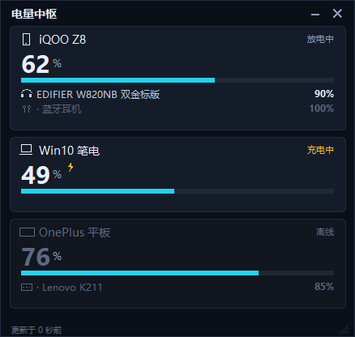
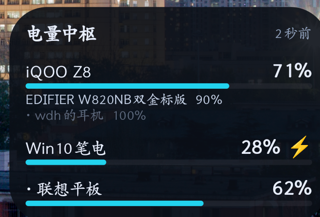

# 电量中枢 · battery-hub

> 把手机、平板、笔记本、蓝牙耳机和键鼠的电量聚到一处，一眼看出谁该充电。
> 一个 Python 进程 + 一个 33 KB 的 APK，没有数据库、没有云服务、没有账号体系。

[](#)
[](#)
[](LICENSE)



| 折叠成一条 | 手机小组件 |
|---|---|
|  |  |

---

## ✨ 特性

- **三端同屏** —— Windows 悬浮窗、Android 桌面小组件、网页面板，5 秒同步
- **手机/平板/笔记本的自身电量**，区分「充电中 / 已充满 / 放电中」
- **蓝牙外设电量** —— 耳机、键盘、鼠标，靠反射隐藏 API 读取
- **多点连接** —— 耳机同时连手机和平板时，两边都显示并标「双设备」
- **跨网络** —— 校园网、4G、热点都能用，不依赖局域网
- **零依赖** —— Python 只用 `psutil` / `paho-mqtt`；Android 手工构建，不打包第三方库
- **读不到 ≠ 没电** —— `null` 一律显示 `—`，不会误导你

## 🚀 快速开始

### 1) 电脑端（约 1 分钟）

```powershell
git clone https://github.com/swydbky/betteryhub
cd betteryhub
python -m pip install -r requirements.txt
.\start-hub.cmd
```

打开 <http://127.0.0.1:18080> 看到面板就成功了。

> 没有 Python？去 [python.org](https://www.python.org/downloads/) 装 3.10+，
> **安装时勾选 `Add python.exe to PATH`**。

### 2) 手机 / 平板（约 3 分钟）

1. 手机浏览器打开 `http://<电脑IP>:18080/apk` 下载 APK
2. 去「文件管理 → 下载」点它安装（不要在浏览器里直接打开）
3. 打开 App，地址框里填 `http://<电脑IP>:18080/report`，点「保存并重启上报」
4. 权限全允许，然后按 [保活指南](docs/keepalive.md) 加白名单

### 3) 跨网络（可选，约 5 分钟）

同一 WiFi 下直连就够用了。**校园网 / 4G / 设备分散**时才需要隧道：

```powershell
# 1) 注册 openfrp.net，建一条 TCP 隧道指向 127.0.0.1:18080（海外节点免实名）
# 2) 把隧道详情页的「配置文件」存成 tools\frp\frpc.toml
# 3) 启动（start-hub.cmd 也会自动带上）
.\tools\start-tunnel.cmd
```

之后手机里的地址改成 `http://<节点域名>:<远程端口>/report`，任何网络都能连。

> ⚠️ 用 `serverAddr` 当访问域名，**不是** `serverName`（那只是 TLS 证书名）。

---

## 🖥️ 三个入口

| 入口 | 位置 | 亮点 |
|---|---|---|
| **电脑悬浮窗** | 屏幕角落，置顶不占任务栏 | 右键菜单：改字体/字号、折叠、调高度；右下角拖拽改大小；滚轮翻页 |
| **手机小组件** | 桌面，三种尺寸 `2×2 / 4×2 / 4×4` | 手指上下滑看更多设备；点一下打开面板 |
| **网页面板** | 任何浏览器 | 5 秒自动刷新，出门在外也能看 |

---

## 🧠 工作原理

```
┌──────────┐  POST /report   ┌─────────────────────────┐
│ 手机 App │ ──────────────► │ PC: hub/hub.py :18080   │
└──────────┘                 │  · 采集本机电量          │
┌──────────┐  POST /report   │  · 接收各设备上报        │
│ 平板 App │ ──────────────► │  · 外设归属仲裁          │
└──────────┘                 │  · state.json 持久化     │
                             └───────────┬─────────────┘
                                         │ GET /state
                    ┌────────────────────┼────────────────────┐
                    ▼                    ▼                    ▼
              PC 悬浮窗            手机/平板小组件          网页面板
             (Python/Tk)          (RemoteViews)
```

设备主动上报，不轮询；中枢只做聚合和展示。

---

## 📐 行为规则

| 规则 | 实际行为 |
|---|---|
| **上报节奏** | 电量变化 ≥1% / 充电翻转 / 外设连断 → **立即**；否则 **10 分钟**心跳 |
| **离线判定** | 中枢 **30 分钟**收不到上报 → 变灰标「离线」 |
| **外设归属** | 连着就挂在那台设备下；多台同时连 → 都挂并标「双设备」；全断开 → 挂到最后连过的那台 |
| **数值语义** | `pct=null` 表示**读不到**，界面显示 `—`，绝不显示 `0%` |
| **节点识别** | 靠 `Build.MODEL` 自动生成 id，同一个 APK 装多台不会互相覆盖 |

---

## ⚠️ 已知限制

| 类别 | 限制 |
|---|---|
| 网络 | 校园网/企业网普遍**隔离客户端**，局域网直连不可用，必须走隧道 |
| 网络 | 组播被禁，**没有自动发现**，地址只能手写或多条回退 |
| 网络 | 部分网络封端口，所以默认用 `18080` 而不是 `8080` |
| Android | 耳机电量依赖**隐藏 API**，某些 ROM 会拦，系统 OTA 后可能失效 |
| Android | 部分鼠标（如 Lenovo M241）不开放电量服务，只能显示「连着、电量 —」 |
| Android | 小组件字号**不能运行时修改**（RemoteViews 限制），尺寸也只能选预设或手动拖 |
| Android | 必须手动加后台白名单，否则会被系统杀掉 |
| Windows | 防火墙若有 `python.exe` 的 Block 规则，会压过端口放行 |
| 功能 | 没有历史曲线、没有低电量提醒、没有账号体系；`http.token` 预留未启用 |

---

## 📚 文档

| 文档 | 给谁看 |
|---|---|
| [使用指南](docs/使用指南.md) | **第一次装的人** —— 从装 Python 到加小组件，含报错修复 |
| [部署手册-给DSH](docs/部署手册-给DSH.md) | **AI 助手** —— 执行清单，只列必须人工完成的步骤 |
| [开发备忘](docs/开发备忘.md) | **改代码的人** —— 数据格式、外设归属、构建方式、踩坑记录 |
| [保活指南](docs/keepalive.md) | 分 ROM 的后台白名单设置 |

---

## 🗺️ 路线图

- [ ] ESP32 桌面屏（ESP32-S3 + ST7789 + LD2410C，人来亮屏）
- [ ] 低电量通知
- [ ] 历史曲线
- [ ] 地址自动发现（等固定 IP / DHCP 保留）

---

## 📄 许可

[MIT](LICENSE)。自行取用，出问题自负。
