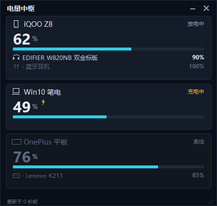
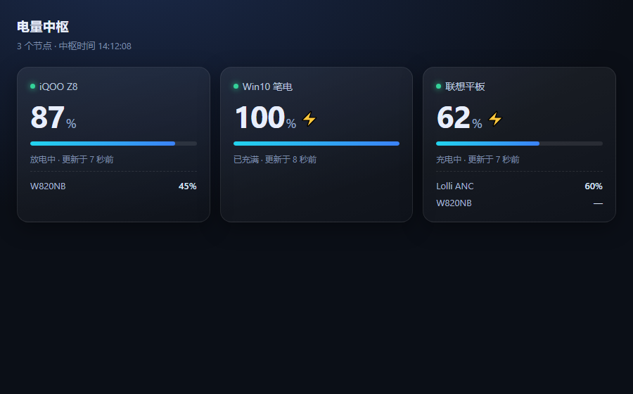

# 电量中枢 · 从零开始完整指南

> 这份文档面向**任何识字的人**：不需要懂编程，照着一步一步做就能从"什么都没有"做到"手机、平板、电脑电量在一个地方看"。
>
> - 文档版本：v1.0（2026-11-19）
> - 对应程序版本：hub 0.2 / APK 34 KB / frpc 0.72.0
> - 全程约 **40～60 分钟**，其中大部分时间在等下载和注册

---

## 目录

- [第 0 章 你会得到什么](#第-0-章-你会得到什么)
- [第 1 章 开始之前](#第-1-章-开始之前)
- [第 2 章 在电脑上跑起「中枢」](#第-2-章-在电脑上跑起中枢)
- [第 3 章 注册 OpenFrp，让外网也能连](#第-3-章-注册-openfrp让外网也能连)
- [第 4 章 给手机 / 平板装 App](#第-4-章-给手机--平板装-app)
- [第 5 章 日常使用](#第-5-章-日常使用)
- [第 6 章 功能说明](#第-6-章-功能说明)
- [第 7 章 额外说明](#第-7-章-额外说明)
- [第 8 章 常见报错与修复](#第-8-章-常见报错与修复)
- [第 9 章 附录](#第-9-章-附录)

---

# 第 0 章 你会得到什么

装好之后，你有 **三个地方** 能看到所有设备的电量：

| 入口 | 长什么样 | 适合什么时候看 |
|---|---|---|
| **电脑桌面悬浮窗** | 一个小窗，浮在屏幕角落，每台设备一张卡 | 坐在电脑前，抬眼看一眼 |
| **手机 / 平板桌面小组件** | 桌面上一块小区域，可以上下滑 | 拿起手机就能看，不用开 App |
| **网页面板** | 浏览器里一个深色页面，5 秒自动刷新 | 任何设备、任何地方，有浏览器就行 |




**它解决什么问题**：以前要知道"耳机还剩多少电、平板是不是该充了"，得挨个设备点开看。
现在一眼扫过去就知道，而且**设备在校园网、在家、在 4G，都能看到**。

---

# 第 1 章 开始之前

## 1.1 你需要准备什么

| 类别 | 要求 | 说明 |
|---|---|---|
| 电脑 | Windows 10 / 11 | 它负责汇总数据，必须一直开着才能看别人 |
| 手机 / 平板 | Android 12 及以上 | 苹果手机**不支持**（读不到耳机电量） |
| 网络 | 能上网即可 | 校园网、家用 WiFi、手机热点都行 |
| 邮箱 | 任意一个能收信的 | 注册 OpenFrp 用 |
| 时间 | 约 40～60 分钟 | 第一次装最花时间的是注册和下载 |

> **只想要局域网版**（所有设备都连同一个 WiFi）可以跳过第 3 章，直接看
> [7.2 不在校园网 / 网络稳定时的用法](#72-不在校园网--网络稳定时的用法可以不上隧道)。

## 1.2 先认识 4 个词

| 词 | 什么意思 | 打个比方 |
|---|---|---|
| **中枢（hub）** | 电脑上跑的一个小程序，负责收集和汇总 | 班长，大家把数据报给班长 |
| **隧道（内网穿透）** | 让外网能找到你家电脑的一条通道 | 给班长配个对外的电话分机 |
| **APK** | 安卓 App 的安装包 | 手机软件的"安装程序" |
| **节点 ID** | 每台设备的自动编号（如 `iqooz8`） | 学号，同一个 App 装到不同机器会自动不同 |

---

# 第 2 章 在电脑上跑起「中枢」

> 这一章做完，电脑本机就能看到电量了。手机还看不到，那是第 3、4 章的事。

## 2.1 安装 Python

1. 打开浏览器，访问 `https://www.python.org/downloads/`
2. 点黄色大按钮 **Download Python 3.x.x**，下载安装包
3. 双击安装包，**⚠️ 第一页最下面一定要勾选 `Add python.exe to PATH`**，然后再点 `Install Now`
4. 等 1～2 分钟，出现 `Setup was successful` 就点 `Close`

**验证是否装好**：按 `Win + R`，输入 `cmd`，回车，在黑窗口里输入：

```
python --version
```

出现 `Python 3.12.x` 之类的字样就成功了。
如果提示 `'python' 不是内部或外部命令`，说明第 3 步没勾 PATH，重装一次即可。

## 2.2 把项目放到电脑上

**方式 A（推荐，能更新）**：装了 Git 的话：

```
git clone https://github.com/swydbky/betteryhub
```

**方式 B（不用 Git）**：浏览器打开

```
https://github.com/swydbky/betteryhub
```

点绿色 **Code** 按钮 → **Download ZIP** → 解压到你喜欢的位置
（例如 `C:\Users\你的用户名\Documents\battery-hub`）。

> ⚠️ 项目路径**不要带中文和空格**，后面脚本更稳。

## 2.3 安装依赖

1. 打开项目文件夹
2. 在地址栏里输入 `cmd` 回车（这样打开的命令行就在当前目录）
3. 输入：

```
pip install -r requirements.txt
```

看到 `Successfully installed paho-mqtt ... psutil ...` 就好了。

> 如果下载很慢，加个国内源：
> `pip install -r requirements.txt -i https://pypi.tuna.tsinghua.edu.cn/simple`

## 2.4 启动中枢

在项目文件夹里**双击 `start-hub.cmd`**。

它会依次做三件事：

1. 启动中枢（后台，看不到窗口，正常）
2. 启动隧道（如果配置过，第 3 章会讲）
3. 启动电脑桌面悬浮窗

**验证**：浏览器打开

```
http://127.0.0.1:18080
```

出现深色面板，并且有一张「本机」的卡片，就成功了。

> 悬浮窗出现在屏幕右上角。看不到的话检查任务栏右下角，或者看看是不是被别的窗口挡住了。

## 2.5 设置开机自启（重要）

不做这一步，电脑一重启就得手动双击一次。

1. 按 `Win + R`，输入：

```
shell:startup
```

2. 回车，会打开"启动"文件夹
3. 把 `start-hub.cmd` **右键 → 创建快捷方式**，把快捷方式拖进这个文件夹
4. 完成。以后开机自动跑起来

> 卸载自启：把那个快捷方式删掉即可。

---

# 第 3 章 注册 OpenFrp，让外网也能连

> **这一章为什么必须有**：校园网 / 公司网会**禁止设备之间互相访问**（叫"客户端隔离"）。
> 实测在校园网里，手机连电脑的 18080 端口，连"握手"都到不了电脑。
> 所以必须给电脑配一条**对外的通道**，让所有设备通过公网地址来访问。

## 3.1 选哪个服务

用 **OpenFrp**（[openfrp.net](https://www.openfrp.net)），理由：

- 免费额度够用：**2 条隧道、1 GB 流量/月、上下行 12 Mbps**
- **海外节点不用实名**（大陆节点要实名，见 3.3）
- 我们的电量数据一个月才几 MB，1 GB 能用几十年

## 3.2 注册账号

1. 打开 [https://www.openfrp.net](https://www.openfrp.net)
2. 点右上角 **注册**
3. 填：
   - **邮箱**：你的常用邮箱（要能收验证码）
   - **密码**：自己设一个
   - **验证码**：按图填
4. 勾选同意协议 → 提交
5. 去邮箱收邮件，点验证链接（没收到就看垃圾邮件）
6. 回到网站 **登录**

## 3.3 要不要实名（可以先跳过）

| 你打算用 | 要不要实名 | 说明 |
|---|---|---|
| **海外节点**（推荐先用） | ❌ 不用 | 免实名，直接能用；延迟 100～200ms，电量数据完全无所谓 |
| 大陆节点 | ✅ 要 | 支付宝刷脸，免费；延迟 20～50ms，更快更稳 |

**先用海外节点**。等哪天觉得慢，再去「个人中心 → 实名认证」补办，然后换大陆节点。

## 3.4 创建隧道

1. 登录后进入**管理面板**
2. 左侧菜单点 **「隧道」**（有的版本叫「我的隧道」）
3. 点 **「创建隧道」**
4. 按下表填写：

| 字段 | 填什么 | 说明 |
|---|---|---|
| 隧道名称 | `battery-hub`（随便写） | 只给你自己看 |
| 隧道类型 | **TCP** | ⚠️ 千万不要选 HTTP/HTTPS，那两个要域名备案 |
| 本地地址 | `127.0.0.1` | 就是电脑自己 |
| 本地端口 | `18080` | 中枢的端口 |
| 节点 | 选一个**海外**节点 | 看"负载"和"延迟"，选负载低的 |
| 远程端口 | **留空** | 系统会自动分配，记住它 |

5. 点 **创建 / 确定**

创建成功后，列表里会出现一条隧道，记下两个东西：

- **隧道名字或 ID**（例如 `NlMn6ym`）
- **远程端口**（例如 `33724`）

## 3.5 复制配置

1. 点进刚创建的隧道，进入**详情页**
2. 找 **「配置文件」** 按钮（有的版本叫「配置」「启动命令」「JSON」）
3. 里面是一段类似这样的文字，**整段复制**：

```toml
serverAddr = 'cn-hk-bgp-4.ofalias.net'
serverPort = 8120
user = '8392a202046c2dbf8d1be71b5d7297a6'

[auth]
method = 'token'
token = 'jAY6ATEUkBZlluDK'

[[proxies]]
localIP = '127.0.0.1'
localPort = 18080
name = 'NlMn6ym'
remotePort = 33724
type = 'tcp'

[transport]
protocol = 'tcp'

[transport.tls]
enable = true
serverName = 'n29d19.openfrp.net'
disableCustomTLSFirstByte = false
```

## 3.6 填到电脑上

1. 在项目文件夹里找到 `tools\frp\` 目录
2. 用**记事本**打开（或新建）文件 `frpc.toml`
3. 把刚才复制的内容**粘贴进去**，保存

> ⚠️ 文件名必须是 `frpc.toml`，不是 `frpc.toml.txt`。
> 记事本保存时把"文件类型"改成"所有文件"，否则会多个 .txt 后缀。

## 3.7 启动隧道并验证

**启动**：双击 `start-hub.cmd`（它现在会自动带上隧道），
或者单独双击 `tools\start-tunnel.cmd`。

**验证 1（看进程）**：按 `Ctrl + Shift + Esc` 打开任务管理器，找 `frpc.exe`，在跑就对了。

**验证 2（看日志）**：用记事本打开 `log\frpc.log`，最后几行应该有：

```
login to server success
[NlMn6ym] start proxy success
```

**验证 3（最重要，外网能否访问）**：
在**手机**浏览器（用 4G，别连 WiFi）打开：

```
http://你的节点域名:你的远程端口
```

例如 `http://cn-hk-bgp-4.ofalias.net:33724`。
能看到面板 = 成功。

> ❓**节点域名**在哪看？就是配置文件里 `serverAddr` 的值，或者隧道详情页"访问地址"那一行。
> ⚠️ **不要用** `serverName` 那个值（例如 `n29d19.openfrp.net`），它只是证书名，解析不出来。

---

# 第 4 章 给手机 / 平板装 App

> 手机和平板装的是**同一个 APK**，会按机型自动区分，不用改。

## 4.1 下载 APK

**方式 A（推荐，用刚才的隧道地址）**：
手机浏览器打开：

```
http://你的节点域名:你的远程端口/apk
```

会自动下载 `probe.apk`（约 34 KB）。

**方式 B（电脑传过去）**：
把项目里的 `android\out\probe.apk` 通过微信/QQ/ToDesk 文件传输发到手机。

## 4.2 安装

1. 打开手机「文件管理 → 下载」，找到 `probe.apk`
   （⚠️ 别在浏览器里直接点"打开"，很容易失败）
2. 点它安装
3. 系统提示"禁止安装未知来源应用"时：
   - 点提示里的**设置**
   - 找到「安装未知应用」→ 允许「浏览器」或「文件管理」
   - 返回再装一次

## 4.3 填写中枢地址

1. 打开 App「电量中枢」（图标名可能是 HubProbe）
2. 会看到一个大输入框，里面已经有地址了
3. **检查第一条是不是你的隧道地址**（形如 `http://xxx:33724/report`）
   - 是 → 直接点 **「保存并重启上报」**
   - 不是 → 把正确地址粘进去（多条用**英文逗号**分隔）
4. 下方提示"已保存 N 条地址"，几秒后开始上报

> **地址格式**：必须是 `http://` 开头、以 `/report` 结尾。
> 手机和电脑不在同一个 WiFi 时，**只填隧道地址**就够了；
> 在同一个 WiFi 时，可以再追一条局域网地址，走得快。

## 4.4 授予权限

第一次打开会弹权限，全部允许：

| 权限 | 为什么 |
|---|---|
| 附近的设备 / 蓝牙 | 读耳机电量必须 |
| 通知 | 常驻服务要显示通知，否则会被杀 |

## 4.5 保活设置（重要，否则经常掉线）

安卓会杀后台。按你的品牌设置：

| 品牌 | 操作路径 |
|---|---|
| iQOO / vivo | 设置 → 电池 → 后台耗电管理 → 电量中枢 → **允许后台高耗电** |
| 一加 / OPPO | 设置 → 电池 → 应用耗电管理 → 电量中枢 → **允许完全后台行为** |
| 小米 / 红米 | 设置 → 应用设置 → 电量中枢 → **省电策略 → 无限制** |
| 华为 / 荣耀 | 设置 → 电池 → 应用启动管理 → 电量中枢 → **手动管理，全开** |
| 三星 | 设置 → 电池 → 后台使用限制 → 把电量中枢加入**永不休眠** |

详细图文见项目里的 `docs/keepalive.md`。

## 4.6 添加桌面小组件

1. 回到手机桌面，**长按空白处**
2. 选 **「小组件」/「窗口小工具」**
3. 找到 **「电量中枢」**，会看到三个条目：

```
电量中枢 2×2     ← 小，一屏约 1 台设备
电量中枢 4×2     ← 中，一屏约 2 台
电量中枢 4×4     ← 大，一屏约 3 台
```

4. 挑一个，**长按拖到桌面**
5. 如果内容超出，**手指在组件里上下滑**就能看剩下的

> 平板同理。

## 4.7 确认成功

做完上面的，等 10 秒，然后**在电脑上**浏览器打开：

```
http://127.0.0.1:18080
```

面板上应该出现你手机的卡片，亮着，显示电量。**恭喜，全部完成。**

---

# 第 5 章 日常使用

## 5.1 三个入口

| 入口 | 打开方式 | 刷新频率 |
|---|---|---|
| 电脑悬浮窗 | 开机自动出现 | 每 5 秒 |
| 手机小组件 | 就在桌面上 | 跟随系统/上报变化 |
| 网页面板 | 浏览器打开中枢地址 | 每 5 秒 |

## 5.2 电脑悬浮窗操作

**左键拖动**窗口移动，**双击**打开网页面板，**右键**出菜单：

| 菜单项 | 作用 |
|---|---|
| 折叠 / 展开 | 收成一条横条，或展开成卡片 |
| **字体与字号…** | 字号 80%～180%，可换字体，改完立刻生效 |
| **恢复自动高度** | 高度回到"内容多高窗口就多高" |
| 刷新 | 立刻拉一次数据 |
| 打开网页面板 | 浏览器打开 |
| 退出 | 关闭悬浮窗（中枢还在后台跑） |

**调大小**：拖右下角的斜纹 —— **横向调宽、纵向调高**。
高度拖小后，内容超出时用**鼠标滚轮**上下翻。

## 5.3 手机小组件操作

- **上下滑**：查看更多设备/外设
- **点击**：打开网页面板
- **长按**：调整大小、删除

## 5.4 数据是怎么更新的

| 情况 | 什么时候上报 |
|---|---|
| 电量变化 ≥ 1% | **立刻** |
| 充电状态翻转（插拔电源） | **立刻** |
| 蓝牙外设连上 / 断开 | **立刻** |
| 其他时候 | 每 **10 分钟**一次心跳 |

**什么时候算离线**：中枢 **30 分钟**收不到某台设备的数据，就把那张卡变灰并标"离线"。

## 5.5 外设电量

手机/平板会自动读已连接的蓝牙设备电量：

- 耳机、键盘、鼠标都能显示
- 一只耳机同时连了两台设备，两台下面都会显示，并标注「双设备」
- 全断开后，会挂到"最后连接的那台"下面，灰显但保留最后的电量
- **有些鼠标（如 Lenovo M241）不开放电量服务**，只能显示"连着，电量 —"，这是设备本身的限制

---

# 第 6 章 功能说明

## 6.1 采集能力

| 设备 | 能采集 | 不能采集 |
|---|---|---|
| Windows 电脑 | 自身电量、充电/已充满/放电 | 未接蓝牙时的外设 |
| Android 手机/平板 | 自身电量、充电状态 | 苹果设备 |
| 蓝牙耳机 | 电量（靠隐藏 API） | 部分老设备 |
| 蓝牙键鼠 | 电量（若设备开放） | 不开放电量服务的型号 |

## 6.2 展示能力

| 功能 | 网页面板 | 电脑悬浮窗 | 手机小组件 |
|---|---|---|---|
| 每台设备电量 | ✅ | ✅ | ✅ |
| 电量进度条 | ✅ | ✅ | ✅ |
| 充电标记 ⚡ | ✅ | ✅ | ✅ |
| 外设电量 | ✅ | ✅ | ✅ |
| 离线灰显 | ✅ | ✅ | ✅ |
| 折叠/紧凑 | ❌ | ✅ | ❌ |
| 改字体字号 | ❌ | ✅ | ❌（系统限制） |
| 拖动改大小 | ❌ | ✅ | ✅（长按） |
| 滑动查看更多 | ❌ | ✅（滚轮） | ✅（手指滑） |

## 6.3 网络能力

| 场景 | 能不能用 | 说明 |
|---|---|---|
| 所有设备同一个 WiFi | ✅ 直连，最快 | 用 `http://电脑IP:18080/report` |
| 校园网（设备互相隔离） | ✅ 走隧道 | 必须用隧道地址 |
| 手机 4G、电脑在家 | ✅ 走隧道 | |
| 电脑关机 | ❌ | 中枢在电脑上，电脑必须开着 |

---

# 第 7 章 额外说明

## 7.1 怎么改手机小组件的尺寸

**方法一：添加时选**（推荐）

添加小组件时列表里有三个选项：`2×2`、`4×2`、`4×4`，直接选。

**方法二：装好后拖边框**（更自由）

1. 长按桌面上的小组件
2. 四周出现**圆点/边框**
3. 按住边缘拖动，**想多大多大**
4. 松手

内容会自动适配：变大就多显示几台，变小就少显示，**都能滑动**。

> **为什么不能"填数字自定义"**：小组件占几格由**桌面启动器**决定，App 只能给建议值
> （`minWidth/minHeight`），没有"让用户输入几行几列"的接口。这是安卓的限制，不是没做。

## 7.2 不在校园网 / 网络稳定时的用法（可以不上隧道）

如果你**所有设备都在同一个 WiFi**（家里、宿舍路由器、手机热点），
直连又快又稳，**完全不需要隧道**。

**做法**：

1. 查电脑的局域网 IP：按 `Win + R` → `cmd` → 输入 `ipconfig`，
   找「无线局域网适配器 WLAN」下面的 `IPv4 地址`，例如 `192.168.1.23`
2. 手机浏览器先验证能打开：`http://192.168.1.23:18080`
3. 能打开就在 App 地址框里填：

```
http://192.168.1.23:18080/report
```

4. 保存即可

**几种常见网络的选择**：

| 你的网络 | 建议 | 原因 |
|---|---|---|
| 家用 WiFi / 宿舍路由器 | **直连 IP**（最快） | 同一网段，延迟 1～3ms |
| 手机热点（电脑连热点） | **直连 IP** | 热点下设备互通，地址由手机分配，较稳定 |
| 校园网 / 公司网 / 公共 WiFi | **必须隧道** | 这类网络普遍隔离客户端 |
| 设备分散在不同网络 | **必须隧道** | 例如电脑在家、你在学校 |

**同时填两条也可以**：把局域网地址放第一条、隧道地址放第二条，
App 会**按顺序试，第一个通的就用** —— 在家走直连（快），出门自动落到隧道。

> 直连模式下，**电脑 IP 变了就要改**。所以长期最省心的还是隧道。

## 7.3 换了电脑 / 换了网络要改什么

| 你做了什么 | 要改什么 |
|---|---|
| 电脑换 WiFi，但仍用隧道 | **什么都不用改**（这就是隧道的价值） |
| 电脑重装系统 | 重做第 2 章；`frpc.toml` 可以直接拷过去 |
| 换一台新电脑 | 重做第 2、3 章；手机 App 里地址改成新的隧道地址 |
| 想换一个 OpenFrp 节点 | 在网站重建隧道 → 更新 `frpc.toml` → 手机 App 里改地址 |
| 手机恢复出厂 | 重装 App，地址重新填一次 |

## 7.4 电脑端改字体和字号

1. 右键悬浮窗 → **「字体与字号…」**
2. 拖「字号」滑块（80%～180%），字会实时变大变小
3. 「字体」下拉里选一个（**只列出你系统里已装的字体**）
4. 想还原：点「恢复默认」

设置会自动保存到 `ui\window.json`，下次开机还在。

## 7.5 数据与隐私

- 所有数据只存在**你自己的电脑**上（`state.json`），不上传任何第三方
- 但**隧道是公共网络**：知道你的隧道地址的人，理论上能查看电量、伪造上报
- 电量数据不敏感，先用着；要收紧可以开 token 鉴权（需要改代码，见第 9 章）
- `tools\frp\frpc.toml` 里有你的 OpenFrp 密钥，**不要发给别人**

## 7.6 备份与迁移

要备份，拷走这几个文件就够：

| 文件 | 内容 |
|---|---|
| `config.json` | 设备别名（你自己起的名） |
| `state.json` | 当前电量缓存（可不备份） |
| `tools\frp\frpc.toml` | 隧道配置（含密钥） |
| `ui\window.json` | 悬浮窗位置、字体、大小 |

---

# 第 8 章 常见报错与修复

> 按"你看到的现象"查表。每条都给了**先做什么**。

## 8.1 手机浏览器打不开面板

**先确认**：是 WiFi 下打不开，还是 4G 也打不开？

| 现象 | 原因 | 处理 |
|---|---|---|
| WiFi 打不开、4G 能打开 | 校园网隔离客户端（正常现象） | **改用隧道地址**，别用局域网 IP |
| 两个都打不开 | 隧道没跑 / 地址错 | 看下面 8.2 |
| 打不开但电脑本机 `127.0.0.1:18080` 正常 | 防火墙拦了 | 见 8.4 |
| 浏览器提示"无法访问此网站" | 域名或端口写错 | 核对是不是 `serverName` 那个证书名，要用 `serverAddr` |

## 8.2 隧道断了 / 连不上

**检查顺序**：

1. 任务管理器里有没有 `frpc.exe`？没有就双击 `tools\start-tunnel.cmd`
2. 看 `log\frpc.log` 最后几行：
   - `login to server success` + `start proxy success` = 正常
   - `connect timeout` = 节点挂了或被墙，**换一个节点重建隧道**
   - `proxy already exists` = 等 30 秒再启动
3. 还是不行：去 OpenFrp 网站看隧道是不是"已停止"，重新启动一下

## 8.3 手机 App 显示离线 / 数据不更新

| 原因 | 处理 |
|---|---|
| App 里地址过期 | 打开 App 看地址框，改成能用的地址，点保存 |
| App 被系统杀了 | 按 4.5 设置保活，然后重新打开 App |
| 数据其实是旧的（差几分钟） | 正常，心跳是 10 分钟一次 |
| 刚改完地址 | 等 10～30 秒 |

## 8.4 电脑本机能打开、别的设备打不开

这是 **Windows 防火墙**问题（校园网/公共网络下最常见）。

按 `Win + X` → 选「Windows PowerShell(管理员)」→ 粘贴执行：

```
New-NetFirewallRule -DisplayName "battery-hub-18080" -Direction Inbound -Protocol TCP -LocalPort 18080 -Action Allow -Profile Any
```

> ⚠️ 另一种坑：如果 `python.exe` 有一条 **Block 规则**，任何端口放行都不生效。
> 先查：
> ```
> netsh advfirewall firewall show rule name=all dir=in | findstr /i python
> ```
> 看到 `Block` 就删掉那条规则。

## 8.5 平板装不上 APK（手机能装）

| 提示 | 原因 | 处理 |
|---|---|---|
| "无法识别此文件" | 下载没存成 `.apk` | 去「文件管理 → 下载」看文件名，不是 .apk 就重下 |
| "禁止安装未知来源" | 权限没给 | 设置 → 应用 → 特殊权限 → **安装未知应用** → 允许浏览器/文件管理 |
| "解析软件包时出现问题" | 下载不完整 | 看文件大小是否为 **34 KB** 左右，不对就重下 |
| "应用未安装" / "签名不一致" | 平板上有旧版本、签名不同 | 先**卸载**旧的电量中枢，再装 |
| 完全没反应 | 浏览器拦截 | 改用「文件管理」打开，或让手机用微信把 APK 传给平板 |

## 8.6 装了新 APK，小组件还是老样子

**必须删掉旧组件重新添加**：长按旧小组件 → 删除 → 重新长按桌面空白 → 添加。

## 8.7 小组件加了但一直显示"还没有节点上报"

1. 先打开 App，确认能看到地址、且点了"保存"
2. 手机浏览器打开面板，确认能看到自己这台设备
3. 都没问题的话：删掉组件重加一次（系统缓存了旧布局）

## 8.8 电脑悬浮窗不见了

| 情况 | 处理 |
|---|---|
| 只是被窗口挡住 | 它是最上层窗口，按 `Alt + Tab` 找不到它（它不进任务栏），先点一下桌面空白处 |
| 跑到屏幕外了 | 关掉它再开一次（会自动回到可见区域），或删 `ui\window.json` 后重启 |
| 真的退出了 | 双击 `start-hub.cmd` |
| 开机没自动起来 | 检查第 2.5 步的启动文件夹里有没有快捷方式 |

## 8.9 电脑端字号调大后字叠在一起

这是旧版本的 bug，新版本已修（卡片高度会跟着字号缩放）。
如果还在用旧版，把字号调回 100%，或更新到最新代码。

## 8.10 端口 8080 用不了

校园网封了 8080。本项目**默认用 18080**，别改成 8080。
如果非要改，改 `config.json` 里的 `http.port`，并同步改防火墙和隧道配置。

## 8.11 中文变成乱码

用 PowerShell 改 JSON 会按 GBK 读写，中文会坏。**一律用记事本或 Python 改**：

```
python -c "import json,io;d=json.load(io.open('config.json',encoding='utf-8'));print(d)"
```

## 8.12 报错"tailscale 劫持路由"

如果你装过 Tailscale，可能会出现"开了就连不上局域网"。本项目**不需要 Tailscale**，
在 Tailscale 里关掉「使用 Tailscale DNS」和「出口节点」即可。

---

# 第 9 章 附录

## 9.1 常用地址一览

| 用途 | 地址 |
|---|---|
| 本机面板 | `http://127.0.0.1:18080` |
| 本机状态接口 | `http://127.0.0.1:18080/state` |
| 本机健康检查 | `http://127.0.0.1:18080/health` |
| 本机下载 APK | `http://127.0.0.1:18080/apk` |
| 外网访问 | `http://你的节点域名:远程端口` |
| 外网下载 APK | `http://你的节点域名:远程端口/apk` |

## 9.2 文件位置

| 文件 | 作用 |
|---|---|
| `start-hub.cmd` | 一键启动（中枢 + 隧道 + 悬浮窗） |
| `hub\hub.py` | 中枢主程序 |
| `hub\dashboard.html` | 网页面板 |
| `ui\pc_widget.py` | 电脑悬浮窗 |
| `android\out\probe.apk` | 手机/平板安装包 |
| `android\probe\hub_urls.txt` | 打包时注入的默认地址清单 |
| `tools\start-tunnel.cmd` | 单独启动隧道 |
| `tools\frp\frpc.toml` | 隧道配置（**含密钥，别外传**） |
| `log\hub.out` | 中枢日志 |
| `log\frpc.log` | 隧道日志 |
| `config.json` | 设备别名等配置 |
| `state.json` | 当前数据缓存 |

## 9.3 命令速查

```
:: 启动（幂等，重复点不会开两个）
start-hub.cmd

:: 只重启中枢
taskkill /f /fi "imagename eq python.exe"
python hub\hub.py

:: 只重启隧道
taskkill /f /im frpc.exe
tools\start-tunnel.cmd

:: 看状态
curl http://127.0.0.1:18080/state

:: 看电脑 IP
ipconfig
```

## 9.4 想加更强的安全（可选）

现在只要知道隧道地址就能看你的电量。要收紧：

1. `config.json` 里设 `"http": {"token": "你自己的一串密码"}`
2. 同时修改 Android 端 `HubService` 的请求头，加上 `X-Token`
3. 重新打包 APK

> 电量数据不敏感，这一步**不是必须的**，嫌麻烦可以不做。

## 9.5 更新版本

```
git pull
pip install -r requirements.txt
```

然后：重启中枢、重新下载 `/apk` 安装、把桌面小组件删掉重加。

---

## 一句话总结

**电脑跑中枢 → 注册 OpenFrp 打通外网 → 手机装 APK 填地址 → 桌面小组件随时看。**
装好一次，以后换网络、换地点都不用再管。
